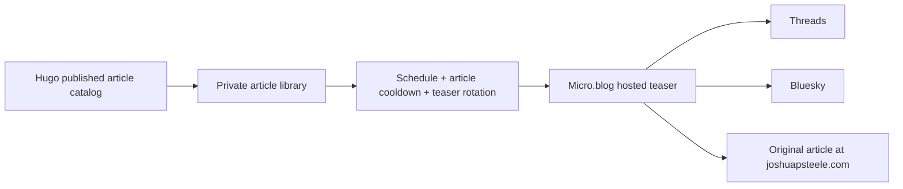

# Evergreen recycler

A small personal replacement for the recycling part of SocialBee/RecurPost/MeetEdgar: approve existing articles, write a few teasers, and let a schedule rotate them through Micro.blog. Python 3.9+ and SQLite; no Python packages, JavaScript dependencies, or build step.

The app is separate from Hugo and is never served by GitHub Pages. Production runs directly with Python and a systemd user service on the existing DigitalOcean droplet alongside LinkLog. See [operations](OPERATIONS.md) for the deployed paths, HTTPS setup, updates, and backups. Docker Compose is an optional alternative.



## What it does

- Import the full published blog archive with Hugo's actual permalinks, including custom URLs. Import recent articles from the existing JSON Feed without a site checkout.
- Search articles, approve them individually, edit multiple teaser variants, and optionally set a stop date.
- Choose weekdays, local time, time zone, minimum article age, and article cooldown. Defaults: Monday/Wednesday/Friday, 10:00 America/New_York, minimum age 30 days, repeat cooldown 90 days.
- Choose the oldest unshared eligible article, then the least recently shared article. Rotate that article's teaser variants on each successful share. Cooldown applies to the article across all variants.
- Preview the next eligible teaser, pause/resume the queue, and inspect the latest 100 attempts.
- Publish an **untitled short teaser with an explicit article link** to a Micro.blog-hosted blog via Micropub. The article remains canonical at joshuapsteele.com. No new Hugo notes, republishing of the original article, or changes to existing feeds.
- Use the selected destination's existing cross-posting configuration. Micro.blog manages Threads and Bluesky credentials and delivery. The recycler needs only a Micro.blog app token.

At three shares per week and a 90-day cooldown, roughly 39 approved articles are needed to fill every slot. If you initially approve 12–15 articles, start with one share per week. The app skips slots when the eligible library is exhausted.

## Local quick start

From this repository root:

```sh
# Create local configuration once; -n preserves an existing file.
cp -n tools/evergreen-recycler/.env.example tools/evergreen-recycler/.env
chmod 600 tools/evergreen-recycler/.env
# Edit .env: fill RECYCLER_ADMIN_TOKEN with a random access key.
# Generate one with: python3 -c 'import secrets; print(secrets.token_urlsafe(32))'
# Add your MICROBLOG_TOKEN when ready to connect. Leave RECYCLER_LIVE=0.

# Save the entire published blog catalog; drafts, future posts, notes and pages are excluded.
hugo list published > /tmp/evergreen-catalog.csv
python3 tools/evergreen-recycler/app.py import --catalog /tmp/evergreen-catalog.csv

python3 tools/evergreen-recycler/app.py serve
```

Open <http://127.0.0.1:8787> and enter the `RECYCLER_ADMIN_TOKEN` value from `.env`. The key is kept in browser memory only, and a refresh locks the dashboard. New articles start unapproved; re-imports preserve their existing approvals and copy. A new database starts paused. `MICROBLOG_TOKEN` is not needed for importing or editing the local library. `RECYCLER_LIVE` defaults to disabled.

The database is in the ignored `state/` directory. The `.env` file is also excluded from Git and Docker builds.

Use `python3 tools/evergreen-recycler/app.py preview` to inspect the next eligible article, or `tick` to run one scheduling check. `tick` obeys pause, schedule, cooldown, and all other rules; it never forces an immediate post. Dry runs do not consume slots or change history. These commands use the same database as the dashboard. Override with `--db /path/to/recycler.sqlite3` **before** the command, or set `RECYCLER_DB`.

Direct Python execution automatically loads `.env` beside `app.py`, regardless of your working directory. Explicit shell exports take precedence. Override the file with `--env-file /path/to/config.env` **before** the command. The file supports plain or quoted values and comments; it does not execute shell code or expand shell variables. Docker Compose reads `.env` automatically too. Restart after editing credentials or `RECYCLER_LIVE`; queue and schedule changes in the dashboard apply without a restart.

Startup errors identify missing/invalid access keys, malformed configuration lines, and occupied ports. If port 8787 is already occupied, open or stop the existing dashboard. Use `serve --port 8788` for a separate dry-run preview; keep only one live scheduler for a given library.

## Micro.blog setup and first live post

1. Create a dedicated app token under Micro.blog Account → App tokens. Put it in `MICROBLOG_TOKEN` on the server; never put it in the browser, a command argument, or Git.
2. Ensure you have a Micro.blog-hosted blog for the teasers. Your existing `social.joshuapsteele.com` may be suitable, but confirm with **Test connection**. An externally hosted Hugo feed alone is not a Micropub writing destination.
3. In the dashboard, click **Test connection**, then copy the exact returned destination `uid` into **Micro.blog destination UID** and save. A UID may use the `.micro.blog` hostname even when the blog uses a custom domain. The worker checks it against the authenticated API before posting.
4. In Micro.blog → Sources, enable automatic Threads and Bluesky cross-posting for the **hosted teaser blog's feed**. Configuring only your Hugo blog/notes feeds does not configure the teaser feed. Disable other services for that feed if you want only Threads and Bluesky. Do not add the same teaser feed twice.
5. Review and approve a small selection of articles with teasers. Each teaser plus its URL must fit within a conservative 280-character budget. The app does not silently truncate or write copy for you.
6. Set a near-future posting slot and check the preview. Set `RECYCLER_LIVE=1`, restart/recreate the service, and resume the queue. At the slot, check the app history, Micro.blog Posts, Threads, and Bluesky.
7. Restore your regular schedule after confirming that one teaser was delivered. The initial live test successfully reached Micro.blog, Threads, and Bluesky; see [operations](OPERATIONS.md) for the verified post URLs.

Only **accepted by Micro.blog** is recorded automatically. Cross-posting is asynchronous and the recycler cannot certify delivery to each social service. Review failures in Micro.blog; retry a failed downstream cross-post there rather than creating another teaser.

Primary API references: [Micropub posting and destination UIDs](https://book.micro.blog/micropub/), [API reference](https://microblog.dev/api/posting/), [automatic cross-posting](https://help.micro.blog/t/automatic-cross-posting-to-mastodon-and-other-services/860), [app tokens](https://help.micro.blog/t/verifying-tokens/102).

## Production droplet

The app is installed at `/home/joshuapsteele/evergreen-recycler` on `linklog-server`. Its systemd user service is enabled with lingering, so it starts at boot and survives SSH logout. Daily verified SQLite backups retain the newest 14 snapshots. The imported library, approvals, current schedule, and first successful post were migrated from the local instance; local live publishing is disabled to keep a single worker active.

The dashboard is live at <https://recycler.joshuapsteele.com>, with verified TLS and authenticated API access. The Caddy installer validated the change, backed up the existing configuration, and preserved LinkLog. DNS configuration, service management, updates, backups, and optional SSH-tunnel access are described in [operations](OPERATIONS.md). Check the live service with:

```sh
ssh linklog-server 'python3 ~/evergreen-recycler/healthcheck.py'
```

## Optional Docker hosting

Copy this directory to the server, or pull it as part of the existing repository. From `tools/evergreen-recycler`:

```sh
cp -n .env.example .env
# Edit .env: generate a random RECYCLER_ADMIN_TOKEN, optionally set MICROBLOG_TOKEN.
# Leave RECYCLER_LIVE=0 while setting up the library.
chmod 600 .env
docker compose up -d --build
docker compose logs --tail 50 recycler
```

The port is bound to server loopback. Access it privately from your Mac:

```sh
ssh -L 8787:127.0.0.1:8787 your-existing-droplet
```

Then open <http://127.0.0.1:8787>. This is the simplest initial setup: no DNS or Caddy changes. Keep the server running for unattended scheduling; your browser and Mac can be closed.

For a mobile-accessible dashboard, add an HTTPS reverse proxy in the existing Caddy configuration for a domain you own:

```caddyfile
recycler.your-domain.example {
  reverse_proxy 127.0.0.1:8787
}
```

Use the random dashboard key over HTTPS. The standard-library HTTP server is intended for private access behind SSH or a reverse proxy; do not expose its raw port publicly. The HTML shell is public to whoever can reach it; all article data and changes require bearer authentication. There are no cookies and no cross-origin API permissions. Production already has DNS and Caddy configured; this section describes an alternative Docker installation.

### Import the full archive into Docker

On the Mac, from the Hugo repo root:

```sh
hugo list published > /tmp/evergreen-catalog.csv
scp /tmp/evergreen-catalog.csv your-existing-droplet:/tmp/evergreen-catalog.csv
```

On the server, from the recycler directory:

```sh
docker compose cp /tmp/evergreen-catalog.csv recycler:/tmp/catalog.csv
docker compose exec recycler python app.py import --catalog /tmp/catalog.csv
```

A full catalog is authoritative: missing URLs are excluded from future recycling, but their copy and history remain for recovery. A recent-feed import is incremental and cannot detect removals from older posts. Re-import the full catalog after article removals or URL changes. Both imports preserve existing approvals and teasers. New URLs need approval.

### Persistence and backup

The named Docker volume stores the database across rebuilds and restarts. Back it up with SQLite's backup API, which produces a consistent snapshot while the app runs:

```sh
docker compose exec recycler python -c "import sqlite3; src=sqlite3.connect('/data/recycler.sqlite3'); dst=sqlite3.connect('/tmp/recycler-backup.sqlite3'); src.backup(dst); dst.close(); src.close()"
docker compose cp recycler:/tmp/recycler-backup.sqlite3 ./recycler-backup.sqlite3
```

Store the backup securely outside this repository. To restore, stop the container, back up its current database, replace `/data/recycler.sqlite3` in its volume with the chosen snapshot, and preserve ownership for UID 10001. Set `RECYCLER_LIVE=0` before recreating the container and reviewing restored history; restore live mode only after checking posts made since the snapshot. Do not use `docker compose down -v` unless you intend to remove the queue and history. Back up `.env` separately in your password manager; it contains credentials.

## Scheduling and duplicate prevention

The worker checks every 60 seconds. It publishes at most one teaser per local calendar day, within the configured slot's grace period (default 60 minutes). A restart during that period can use the current slot. Older missed slots are skipped; there is no catch-up burst. Time zones and daylight saving time use Python's IANA zone database. A nonexistent DST spring-forward slot is skipped; a repeated fall-back slot has one calendar-day claim.

SQLite transactions and a unique daily slot serialize concurrent workers. The attempt is durably recorded **before** the POST. Accepted requests increment article shares and start the cooldown. HTTP rejections do not start the article cooldown, but consume the slot to avoid repeated failures.

Network timeouts, unexpected HTTP responses, and server errors may mean the teaser was accepted despite a lost response. They become **uncertain** and block the entire queue. A crash after claiming a slot leaves **sending**, which also blocks. Check Micro.blog Posts, then record **It was published** or **It was not published** in history. A sending record cannot be reconciled during its first five minutes because the request might still be in flight. Reconciliation does not retry that day's slot.

This trades occasional missed shares for avoiding automatic duplicate posts. Exactly-once delivery cannot be guaranteed across SQLite and a remote API without provider idempotency; manual reconciliation handles that gap. Pausing stops future requests; an already submitted request may finish.

## Scope and verification

This version intentionally covers a single personal queue: reviewed teasers, rotation, scheduling, and a Micro.blog publishing adapter. Category-specific schedules, image attachments, generated copy, engagement analytics, importing historic social shares, and automatic per-network delivery checks are not implemented. It starts its own share history; if you shared an article recently elsewhere, keep it unapproved until ready to recycle.

Run the behavior tests and site verification from the repository root:

```sh
python3 -m unittest discover -s tests -p 'test_evergreen_recycler.py'
node --check tools/evergreen-recycler/app.js
npm test
npm run build
```

Verification: 24 recycler tests cover queue behavior, startup diagnostics, local configuration loading, and backup integrity/retention. The existing Python/JavaScript regression tests, Hugo production build, and rendered-site checks pass. Browser checks covered login, searching the 333-article library, saving a teaser draft, and saving schedule settings. One live teaser was accepted by Micro.blog; Josh confirmed Threads and Bluesky delivery. On the droplet, Micro.blog connectivity, database migration, service persistence, and backup creation were verified. Public DNS and TLS verification succeed; the dashboard and authenticated API return 200, unauthenticated API requests return 401, and LinkLog still returns 200 after the Caddy change. Docker is optional and has not been run.
